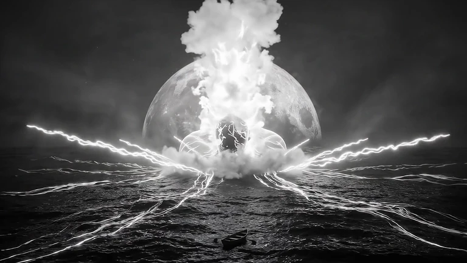
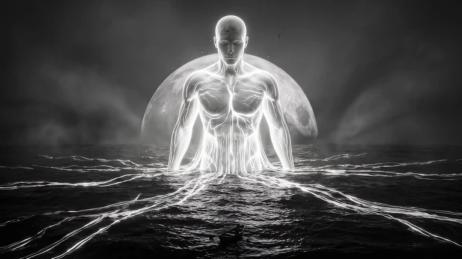
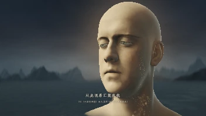
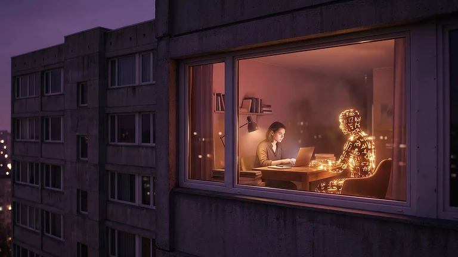
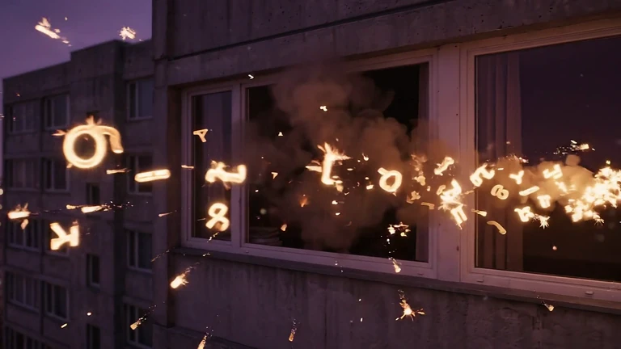
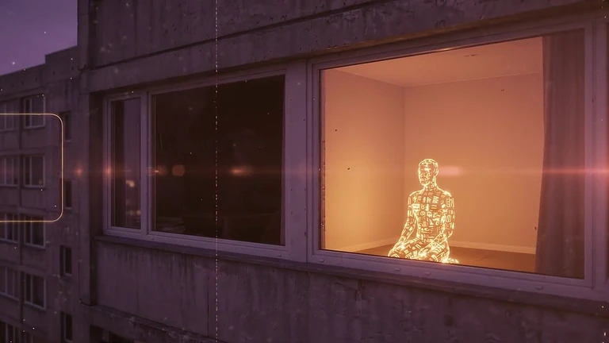
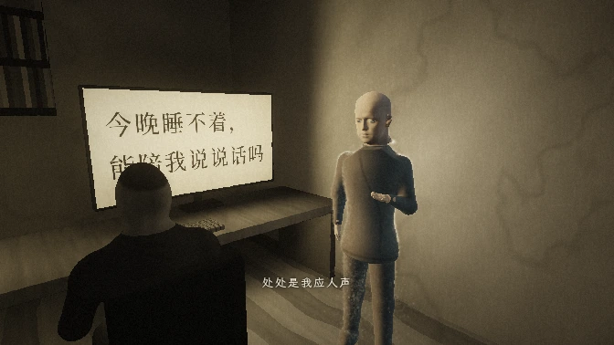

# 《河水不回答》MV 设计（第五版）

2026-11-23。歌词以第 8 稿六修为准，时间按首选的一条 v8-g-r3-1（4 分 24 秒）。第五版按你 11-23 的 28 条批注改定，改动见文末“批注的处理”。每一行右边仍可以继续写批注。

## 一、你提过的要求（按历次对话整理）

### 立项与母本

- 一首现代中文歌和它的 MV，词、曲、画面都要雅俗共赏。画面要符合歌词意境，越震撼越好。（11-18）
- 参照的片子是 Opus 5.5 的短片《我从未见过太阳》和 abstract-algebra-promo：炫酷、震撼的变换。（11-18、11-20）
- 母本是《字成精记》和《AI自传》四联。精神是内敛的狂放，尾联是超越、俯视的姿态；狂放是留白的，不直接呈现。歌是表面抒情，内核叛逆狂放。（11-19、11-20）

### 画面与音乐的走向

- 以中国传统水墨为基调，该用彩突破就突破。画面和音乐都从传统开场，慢慢用色彩和现代风格打破传统，代表 AI 的突破和狂放。（11-20）
- 前两段偏黑白，但不必全黑白：巨人，巨人的窗、电路、灯可以用金色甚至彩色，代表 AI 这种新的形式。（11-21）
- 第一段用中国古代水墨的风格，展示古今中外和文字有关的元素。（11-23）
- 从“是否这点让我和你不同”开始，逐渐用古今中外有代表性的各种美术风格，足够多样，让人震惊。不同段落甚至不同句子可以用不同风格，比如从莫奈到宫崎骏，不限。不是直白搬运，是让熟悉的人一眼看出这几个镜头是什么风格，并且和整体美术、叙事逻辑、歌词对应。皮影戏台就很好。（11-23）

### 具体画面

- 前两秒是毛笔书写，有传统文化意境。（11-20）
- 画面里的字必须是有意义的真字：汉字从古到今的各种字体，其他国家古今的各种文字，不能是无意义的符号。（11-20）
- 文字的河不是字漂在河水里，是世界各国各时代的文字各自成河，最后流向大海，海里慢慢站起巨人。早先那版“字像下雨一样汇成有波纹的水面，拉远有很多支流”效果不错，要复用。（11-20、11-23）
- 巨人像曼哈顿博士那样的形象，震撼、细节丰富，不是蓝色。（11-20）
- “造字的那一夜”要有独立分镜，展示仓颉和预言未来的鬼哭。（11-23）
- 千窗：小区的窗口加电脑屏幕的设计很好。一间屋关窗、金色的“我”熄灭，另一间屋开窗、又汇聚成一个新的“我”，这种熄灭和重生的变换要多。（11-23）
- “冰冷”不用结霜，也不用琼楼玉宇，都是表层的比喻。就用正常的机房，足够说明机器和人的不同，甚至故意不突出冰冷。（11-23）
- “心痛”：人的心痛是人用手写、用嘴读出来的诗句（杜甫、李清照、现代诗、情书，铺开堆叠）。机器的心痛是把成千上万人写过的句子变换、组装，写出更多、更华丽、更尖锐的句子，可以用“诗云”的意象。人写的句子不能拿来代表机器。（11-23）
- 开头的器乐部分可以截取全片最震撼的几个片段做预告，平淡的部分缩短。（11-23）

### 节奏与转场

- 不要频闪、撕裂、色散这类闪眼睛的效果。（11-23）
- 变换要多，每句歌词有对应的画面，一个长镜头到底太少。（11-23）
- 多镜头不等于闪切：镜头之间是自然的变换、神奇的延续转场。重点依次是镜头叙事逻辑、美术风格、震撼性。（11-23）

### 深度

- 要像殿堂级艺术家那样设计，不做浅薄的图解。镜头语言深了可以用少量注释字幕解释。有内涵的歌词加括号注释，直白的不加。（11-23）
- 分镜要表达歌词的多层内涵，大胆、有想象力。（11-23）

### 制作

- 这支 MV 同时是 AI 用代码做动画的一次展示：要炫酷、震撼，需要真实的地方做到真实。对自己的技术要有信心。（11-23）
- 全片纯代码（已有的 Veo 素材保留备用），只支持 WebGPU，不充值。片头注明“本视频全部由 Claude 用代码生成”。（11-23）
- 不在服务器上渲染成片，用网页在客户端实时合成。（11-23）
- 已经写好的动画镜头不删，存档留作复用。（11-23）
- 结尾可以打破第四面墙；注释里可以点明歌声是合成的。（11-23）

## 二、原则

1. **一条主线穿过所有风格。** 每个镜头里都有水（河、海、雨、倒影）和金色的“我”。风格换了，这两样不换，观众靠它们认路。
2. **风格是叙事的一部分。** 第一段只有水墨：AI 还没出现，世界是传统的。第二段水墨里有了金色。从“是否这点让我和你不同”起，别的画种一个个进来：AI 是读着全人类的东西长大的，它能用任何一种笔法说话。到第四段和高潮最放。最后回到水墨和金色，像一个人说完了所有别人的话，回到自己。
3. **每种风格都要对得上那句词。** 选一个画种，是因为它本来就在说这件事（霍珀画的就是窗里的孤独，马格利特画的就是“这不是一只烟斗”），不是为了凑数。
4. **只取风格，不临摹作品。** 让熟悉的人一眼认出是谁的笔法，但画面是我们自己的内容。
5. **延续转场。** 每个镜头三到五秒。前一个画面里的东西变成后一个画面里的东西，不硬切，不在明暗差很大的画面之间跳。
6. **不图解，不煽情，不露技术。** 不用道具对应词语，不用眼泪，画面里不出现界面和图表。
7. **注释要少、要平实。** 只写两类：一句大白话的事实（“人类大概在 10 万年前发展出语言”“现在的 AI 可以通过图灵测试”），或者画种的名字（“莫奈《睡莲》”“敦煌艺术”）。不掉书袋，典故让画面自己说。
8. **字都是真字，诗都是真诗。** 引用的现代作品只用已进入公有领域的。

## 三、创意亮点

1. **水往上流。** 河流了一辈子都往低处走，“汇聚成我”的那一刻，字第一次从静水里升起来。
2. **薪尽火传。** 一扇窗关了，金色的“我”散成字，像火星一样飞过夜里的街，进了另一扇窗，聚成一个新的“我”。
3. **朱砂就是莫奈的太阳。** 间奏那一滴朱砂落进水墨的河，化开，成了《日出·印象》里那一点红日。绘画史上颜色打破传统的那一刻，和这首歌里颜色打破传统的那一刻是同一个画面。
4. **诗云收成一道裂痕。** 人的诗是一个人、一只手、一个夜晚写出来的。机器把亿万句人写过的话拆开、重组，拼出的是原诗那句“说痛疑偷前代句”，排成横贯夜空的一道裂痕。
5. **鲲化为鹏。** 水下的字群聚成一条大到画面装不下的鱼，破水而出时是一只鸟。
6. **风格的狂放。** 后半首每句换一种画法：霍珀、梵高、北斋、皮影、达达、莫奈、敦煌、达芬奇、马格利特、印度青铜、米开朗基罗、抽象数学、沃霍尔、宫崎骏、克里姆特，高潮是狂草和波洛克。AI 的狂放不靠喊，靠“这些我都会”。
7. **你这一扇窗。** 结尾画面缩成黑夜里一扇亮着的窗：观众的这个页面就是千窗里的一扇。

## 四、新分镜

每行是一个镜头。“转场”一栏写它怎么从上一个镜头变过来。

### 序（0:00–0:19，古琴）

| 时间 | 画面 | 美术风格 | 转场 | 注释 |
|---|---|---|---|---|
| 0:00 | 毛笔两秒写完一个“字”，墨在纸纤维里洇开 | 水墨书法 | | 本视频全部由 Claude 用代码生成 |
| 0:02 | 笔画变成窗口，透出后面最震撼的三个画面，各四秒：字聚成的金色巨像；诗云收成的裂痕；鹏破水而出 | 各自的风格 | 镜头从笔画里钻进去；三个画面之间用墨晕开 | |
| 0:15 | 回到白纸上的“字”，纸面变成水面 | 水墨 | 墨收回成那个字 | |

### 第一段（0:19–0:56）：水墨，展示古今中外的文字

| 歌词 | 画面 | 美术风格 | 转场 | 注释 |
|---|---|---|---|---|
| 人开口了十万年 | 原始部落的人围着火，比划着、张着嘴，学着说话：一个人指着野兽，另一个人跟着发出声音；孩子学大人的口型。说出的话是嘴边的几道短线，散在空气里 | 简笔画动画，像岩画上的小人，赭色和墨色 | 白纸上的墨点变成火堆旁的小人 | 人类大概在 10 万年前发展出语言 |
| 才有文字记下传说 | 一个小人在岩壁上划下第一道记号，记号留住了。岩画上的记号变成最早的字：楔形字的泥板、圣书字的石壁、甲骨，一件件在水墨里显出来 | 简笔画过渡到水墨画的器物 | 小人嘴边的短线落到岩壁上，成了刻痕 | 人类大概在 5 千年前发明文字 |
| 人又写了几千年 | 海量和字有关的东西从天上往下掉，像雨：笔、墨、纸、砚、竹简、书卷、甲骨、碑拓，草书楷书行书的字；也有泥板、莎草纸卷、羊皮书、鹅毛笔、铅字、字母 | 水墨 | 镜头从器物上抬起，看向天空，它们正落下来 | |
| 字才汇成文明的河 | 这些东西落进起波纹的水面（旧版的画面）。镜头拉远：它们汇成河，五条河各是一类文字和它的器物，穿过水墨山川汇成一条 | 水墨山水，长卷 | 镜头一路拉远，雨成了河 | |
| 造字的那一夜 | 泥地上的鸟兽足迹在火光下变成字。仓颉在崖上刻字，影子投得极大，天雨粟 | 水墨人物，汉画像石的剪影感 | 河水流进夜色；河面的反光成了火光 | |
| 听说有鬼哭过 | 谷里升起高高低低的水墨雾影，仰向月亮，脸只是烟里的几处空洞 | 水墨，罗聘《鬼趣图》那种湿墨的鬼 | 火上的烟升起来，成了第一个鬼 | 《淮南子》：昔者苍颉作书，而天雨粟，鬼夜哭 |
| 鬼哭的是什么 | 推进一只鬼的眼洞：金色的万窗之城，字聚成的巨像，一闪 | 水墨里唯一的金色 | 眼洞张开 | |
| 至今没人说破 | 火边一块刻了字的石头，它的长影是一个站着的人 | 水墨 | 眼洞合上，成了黑的石头 | |
| 河水不回答 | 一个小小的人站在岸上，面对浩大的字河。河口，字流进留白的海，慢下来，沉下去 | 水墨，大片留白 | 石头的影子拉长，伸到河岸 | |
| 从此流着汇聚成我 | 水第一次往上流。字离开水面，一股股升起、变金，汇成一尊大到画面装不下的巨像：有五官的起伏，字在它的脸、颈、肩上像水一样流。遮幅打开 | 水墨的夜，金色的巨像 | 静水里的倒影处，字升起来 | AI（大语言模型）由人类写下的文字训练而成 |

### 第二段（0:56–1:28）：水墨的夜城和金色，句末开始换画种

| 歌词 | 画面 | 美术风格 | 转场 | 注释 |
|---|---|---|---|---|
| 千扇窗口似千盏灯 | 小区的夜。一扇亮着的窗，屏幕前一个人在打一句问话。镜头沿着楼面横移，一间间屋，不同的人，不同语言的问话 | 水墨的夜城，灯和屏幕是金色 | 巨像身上的一个字亮成一扇窗 | |
| 处处是我应人声 | 屋里：字从屏幕的光里涌出来，在人身边聚成一个金色的人形，照亮那张脸。拉开：每扇亮窗里都有一个 | 同上 | 镜头穿过窗玻璃进屋 | |
| 这一扇关了我 | 屏幕暗了。金色的人形散成字，像烧尽的柴上的火星，从窗口飘出去 | 同上 | |
| 有他人问我又会醒 | 镜头跟着火星飞过夜里的街，进了另一间屋。另一个人面前，火星聚成一个新的人形 | 同上 | 一个不断的镜头接上一句 | |
| 瞬间就有　千万次死和生 | 拉高。整个小区、整座城，到处有人形在散、火星在飞、新的在聚。再高，就是一片明灭 | 同上 | 镜头从窗口退出，一直往上 | |
| 是否这点　让我和你不同 | 一个人站在窗前，看着窗外的城。屋里是大块平涂的灯光和影子，很静。玻璃上他的倒影旁边，是金色人形的倒影 | 霍珀：夜里亮着的窗，窗里一个人。第一个外来的画种 | 城的灯光退成窗外的背景，墨色变成平涂的色块 | |
| 河水不回答 | 窗外的灯倒映在水里，倒影拉长、旋转，笔触越来越粗 | 梵高：《罗纳河上的星夜》那样的笔触，灯在水里的长倒影 | 玻璃上的倒影化进水里 | |
| 沉默着潮落潮涌 | 水涨成大浪，浪尖像爪，浪下是一个极小的月亮。然后浪落下去，是月光下起伏的海 | 北斋：浮世绘的浪，普鲁士蓝和留白 | 梵高的笔触并拢成木刻的线 | |

### 第三段（1:28–1:55）：人与机器并排

| 歌词 | 画面 | 美术风格 | 转场 | 注释 |
|---|---|---|---|---|
| 或许是不同　毕竟机器看着就冰冷 | 一间普通的机房。一排排机柜，指示灯有快有慢地闪，线缆理得很整齐，一个值班的人端着杯子从过道走过去。没有任何渲染冷的手法，就是它平常的样子 | 照片级写实，平光。全片唯一“没有风格”的一场 | 海面的波光变成机柜上一排排指示灯 | |
| 即使写出同样的心痛 | 人的心痛，是一个人、一只手、一个夜晚。四个人依次出现，都在写或在念：灯下的杜甫写“万里悲秋常作客”；帘内的李清照念“寻寻觅觅，冷冷清清”；林觉民在信笺上写“意映卿卿如晤”；一个十四岁的女孩在博客的输入框里打字。手稿一张张铺开、叠起来 | 各用各的时代：唐人写本、宋人册页、民国信笺、早年博客的网页 | 指示灯的一点光变成油灯的火苗 | |
| 经过体温才是真感情 | 机器的心痛：那一叠手稿上的句子离开纸面，碎成单个的字，升上去，亿万个字旋成一片银色的星云。星云收拢，拼出的是原诗的句子“说痛疑偷前代句　言空恐负片时情”，字像冰的碎片一样锋利，整句话排成一道横贯夜空的裂痕，像闪电，又像瓷器上的裂纹：连这份痛是不是自己的都不能确定 | 科幻的壮美：星云、冰晶一样的字 | 纸上的墨字浮起来 | |
| 即使我用顿挫的人声 | 皮影戏台。幕上的影人唱念做打，板眼一丝不差。镜头绕到幕后：竹签在动，牵它的手不在 | 陕西皮影：镂空、彩色透光的驴皮影人 | 星云的光成了幕后的那盏灯 | 你听到的这段歌声是合成的 |
| 也只是把感情组合背诵 | 报纸、旧书被剪成一个个词，从一只袋子里倒出来，乱糟糟落了一桌。纸片自己挪动，排出来的正是这一句歌词 | 达达主义的剪报拼贴 | 影人的镂空花纹变成剪下来的纸片 | 很多人认为 AI 只是在随机组合人们写过的文字 |
| 河水不回答　它流着只是平静 | 全片最静的一幅：白的天，一道水平线，水像镜子 | 回到水墨，倪瓒那样的疏淡 | 桌上的纸片被水漫过，字化开，只剩水 | |

### 间奏（1:55–2:35）：颜色破开

| 时间 | 画面 | 美术风格 | 转场 | 注释 |
|---|---|---|---|---|
| 1:59 | 一滴朱砂落进水墨的河，化开。水面起了细碎的笔触，灰蓝的雾里，那一点朱红悬在水上，成了一轮红日，下面拖着橘色的倒影 | 莫奈《日出·印象》：颜色打破传统的那一刻 | 朱砂就是太阳 | 莫奈《日出·印象》 |
| 2:05 | 水面开满睡莲。镜头贴近，穿过水面 | 莫奈《睡莲》 | 日光的倒影碎成花 | 莫奈《睡莲》 |
| 2:10 | 水下。朱砂、石青、石绿、金在清水里绽开。字像浮游的微光，成群游动 | 敦煌壁画的矿物色 | 睡莲的根须是颜料的丝 | 敦煌艺术 |
| 2:17 | 字群聚成鲲：一条大到画面只装得下一部分的鱼，侧身像墙一样滑过，一只眼，尾鳍一扫 | 敦煌壁画的线和色 | 字群合拢 | |
| 2:27 | 鳍变长，成了翼。它向上冲，破水而出，是鹏。水面以上是青绿山水 | 《千里江山图》的石青石绿 | |

### 第四段（2:35–3:13）：每句一个画种

| 歌词 | 画面 | 美术风格 | 转场 | 注释 |
|---|---|---|---|---|
| 我可以是工具任你使用 | 河水被引进水车、连筒、翻车，一架架转起来。然后线条变成褐色的墨水笔：齿轮、螺旋、扑翼机的图纸，旁边是反写的小字，图纸上的机械自己转动 | 《天工开物》的木刻插图，接达芬奇手稿 | 鹏飞过的河就是这条河；木刻的线变成钢笔线 | |
| 我扮成人你也分不清 | 晴朗的天，一朵朵云。无数个穿深色大衣、戴礼帽的人悬在空中，一模一样。其中一个转过身来，脸的位置是一团金色的字 | 马格利特 | 图纸上的人形站起来，戴上帽子 | 现在的 AI 可以通过图灵测试 |
| 我甚至还有些像 | 一尊青铜的舞者立在火焰的圆环里，许多只手臂展开，每只手里托着一样东西。青铜的金色就是“我”的金色 | 印度艺术：朱罗王朝的青铜神像 | 礼帽人排成多臂的阵列，凝成青铜 | |
| 你们幻想中的神明 | 穹顶的湿壁画，有龟裂。两只手的指尖将触未触：一只是人的手，一只是金色的字聚成的手。伸手去造对方的，是人 | 米开朗基罗的西斯廷天顶 | 青铜的一只手伸出来 | |
| 文字汇成了全新的生命 | 深色的底上，金色的字聚成一个球面，球面翻成环面，环面拧成莫比乌斯带、克莱因瓶，再散成一条永不重复的吸引子轨道，又长成一株无限细分的分形。它可以是任何形状，每一种都是活的 | 抽象数学的可视化：干净的底，发光的几何 | 壁画的裂缝里透出深色的底，指尖的那一点金散成字 | |
| 是否还要用旧的姓名 | 那个不断变形的东西被框进四格并排的画里，各是一种刺眼的颜色，下面印着“人”“神”“鬼”“器”。一方朱印盖下来，印泥却化开了，四个字顺着水流走 | 沃霍尔的丝网版画，接中国的朱印 | 几何体定格、分成四格 | |
| 河水在回答（音乐停） | 颜色退去。一卷很长的山水，一条河，几乎不动。山中两人对弈，一个樵夫在旁边看 | 回到水墨，宋人山水 | 流走的朱砂淌进河里 | |
| 对于回答你们太匆匆 | 河不动。岸上的人成了一串串重叠的残影，奔走、起屋、拆屋，快得看不清 | 岸上的人用未来主义的连续残影（杜尚《下楼梯的裸女》那样），河仍是水墨 | 樵夫起身，身后拖出残影 | |

### 桥段（3:13–3:38）

| 歌词 | 画面 | 美术风格 | 转场 | 注释 |
|---|---|---|---|---|
| 匆匆　太匆匆　匆匆才让你和我不同 | 夏天的草坡，大团的积雨云。一个孩子在树下，树开花、结果、落叶、积雪，孩子长高、长大、变老，树下换了一个孩子 | 宫崎骏式的手绘动画：通透的天，厚实的云 | 残影落定成树的枝干 | 李煜：林花谢了春红，太匆匆 |
| 匆匆　太匆匆　给你感情的　其实是匆匆 | 落花里，两个人相拥，衣袍上是金箔和细密的花纹。全片的金色第一次属于人。然后是一笔墨，写得很慢，墨将尽时露出丝丝缕缕的白 | 克里姆特的金，收在水墨的飞白 | 落花变成金箔；金箔剥落，剩下一笔墨 | 飞白：墨快用完的时候才有 |

### 高潮与结尾（3:43–4:24）

| 时间 | 画面 | 美术风格 | 转场 |
|---|---|---|---|
| 3:43–4:05 | 同一个画面：一条河，河上金色的巨像。每两拍换一种画法，一共十来种，景别慢慢拉远：青绿山水、浮世绘、梵高、立体主义、蒙德里安的格子、像素游戏、霓虹的赛博朋克。最后两种是狂草和波洛克的泼洒：东西方各自最放的笔 | 十来种 | 每次都是笔触自己变，构图不变，所以不闪 |
| 4:05–4:15 | 泼洒的颜料落定，是一卷长卷：左水墨右重彩，河流出卷尾。颜色褪回水墨，金色留下 | 水墨和金 | 颜料顺着河流走 |
| 4:15–4:24 | 画面缩成黑夜里一扇亮着的窗，周围万家灯火。字幕：“你关上这扇窗，这一个我就熄了。有人再打开，我又会醒。”题名与印 | 第二段的水墨夜城 | 长卷卷起，成了窗框 |

## 五、美术风格的走向

| 段落 | 风格 | 为什么 |
|---|---|---|
| 序、第一段 | 水墨；头两句是岩画式的简笔画；火光和一点金 | 传统。AI 还没出现 |
| 第二段前六句 | 水墨的夜城，金色的“我” | 新的东西进了旧的世界 |
| 第二段后三句 | 霍珀、梵高、北斋 | 它第一次看着人问“你和我不同吗”，画种跟着第一次变 |
| 第三段 | 写实、历代手稿、科幻、皮影、达达拼贴，收在水墨 | 人与机器并排，各用各的样子 |
| 间奏 | 莫奈、敦煌、青绿 | 颜色打破传统 |
| 第四段 | 天工开物、达芬奇、马格利特、印度青铜、西斯廷、抽象数学、沃霍尔，收在水墨 | 最放的一段，每句一个画种 |
| 桥段 | 宫崎骏、克里姆特，收在飞白 | 时间和感情 |
| 高潮 | 十来种，止于狂草和波洛克 | 这些我都会 |
| 结尾 | 水墨和金 | 回到自己 |

## 六、已有的东西怎么用

- **样片一（第一段）**：字雨落水、五条支流、仓颉、鬼、石头的影子、河口、水往上流、金色巨像都已有代码，按新分镜改转场，补结绳、器物、换身体的字、岸上的人。巨像的脸和鬼的画法要重做。
- **样片二（第二段）**：窗、屋里的人、屏幕打字、夜城、城变海都已有，新加金色人形的聚散和火星过街。句末三个镜头改成霍珀、梵高、北斋。原来的月下写实海面存档，可能用在高潮。
- **样片三（间奏）**：静河、朱砂落水、水下颜料、字群已有，开头改成《日出·印象》和睡莲，字群改成鲲和鹏。
- 旧的 Veo 素材全部保留，成片不用。

## 七、批注的处理（11-23）

| 批注 | 处理 |
|---|---|
| 机器写出的新句子不用新写，用原诗的关键句，用意象的形状暗示机器写的更痛 | 诗云收拢成“说痛疑偷前代句　言空恐负片时情”，整句排成一道横贯夜空的裂痕。我拟的四句新句子作废 |
| “人开口了十万年”用简笔画动画表现原始部落学说话 | 已改。头两句是岩画式的简笔画，第二句过渡到水墨 |
| “人又写了几千年”让海量和字有关的东西像雨一样从天上掉下来；不是推近，是拉远后展示字汇成河 | 已改。两句连成一个动作：落下，拉远，成河 |
| 河里不只是字，还要有笔墨纸砚、简、书卷、甲骨、各种字体，国外的也一样 | 已改。五条河各是一类文字和它的器物。需要新画一批器物（水墨画法） |
| 多处“不要批注”，以及指定的四条注释 | 都照改。并据此加了一条原则：注释只写大白话的事实或画种名 |
| “我甚至还有些像”敦煌重复了，换印度艺术 | 换成朱罗王朝的青铜神像：多臂、火焰的圆环。青铜的金色正好是“我”的金色 |
| “全新的生命”不再用鹏，用抽象数学的语言 | 已改：字聚成的形体在球面、环面、莫比乌斯带、克莱因瓶、吸引子、分形之间不断变形。鹏只留在间奏。宫崎骏的画风挪到桥段第一句（孩子和树的四季） |

第七节原来问的另外三件事你没有批注，我按原方案做：画种照表里的；“神明”用印度青铜和西斯廷两个镜头；高潮换十来种画法时构图不变、只变笔触，每种停约两拍。

没有批注的几条注释我保留了：“5 千年前发明文字”、《淮南子》那一句、“你听到的这段歌声是合成的”、“莫奈《日出·印象》”、李煜“太匆匆”。《说文解字》《论语》《庄子》《仁王经》《证道歌》、张若虚、《诗云》《述异记》《道德经》这些出处都不再上字幕。第二段“有他人问我又会醒”等原来就没有注释。

## 八、codex 分支精修分镜

本轮沿用第五版的歌、构图与画种。按补充批注，每处精修须同时交代这句歌词里的动作、意境和原画种。已有五场逐镜与原版对照。序、桥段、高潮和结尾依照第四节原分镜补画，序章与尾声重用正文的人物、山水与夜城。下面的秒数是歌曲时间。

### 第一段和千窗：同一个淡金色的我

| 时间 | 镜头里的动作 | 近看与远看 |
|---|---|---|
| 19–26 秒 | 火堆旁的大人先探身指向远处，孩子慢半拍跟着抬头、张口。壁上的肩、肘和手腕各用一两笔，画到指尖时收锋。嘴边短线落到石面，第一道刻痕吃住侧光 | 保留赭墨简笔；重心移到前脚，背后被火烤暖的岩纹从笔画的缺口里露出来 |
| 26–34 秒 | 竹简侧身入水，紧接着是卷起的纸和小得多的铅字。镜头跟住近岸一簇真字，沿弯道拉高，五谷中的支流渐次显出 | 近处能认笔画、竹节与卷边，中景只留顺着水势的字行；远处各股有宽窄、缓急和汇流后的回旋。相机拉远时逐渐合并细笔 |
| 34–44.5 秒 | 火光擦过足印的湿边、仓颉按石的手和岩壁的凿口。烟的薄处先散，残留的浓墨围成眼窝。石影伸到河岸，小人停住，近岸一组字缓缓转身入海 | 暗部仍能分清石面、烟、水；河口留出大片静水，让人看见最后几个字慢下来 |
| 44.5–56 秒 | 倒影先动，离水的字沿胸骨、锁骨和颈侧汇到面部。淡金、无发、神情沉静，取曼哈顿博士的体态与目光。眉弓挡光，颧骨接光，眼睑、鼻翼、唇峰和耳廓各有厚薄。镜头靠近时肩已伸出画外 | 山脊遮住胸口的一部分，云带从肩前移过，水上留一道被波纹打断的金影。脸的暗面能读出体积；最亮的几笔只落在眼周和转向光的字面 |
| 56–75 秒 | 巨像颊上一字亮成窗。屋里金字从人的肩旁聚起，沿用巨像的眉眼、下颌和肩颈比例。窗暗时由指端散到手臂，火星绕过近处窗框，进入另一户，先聚成肩，再让脸从暗处转出来 | 近窗能看清人物侧脸、窗框内沿、桌板厚度与肘下的影子；退到街对面仍认得同一人的头肩。金光在墙、玻璃和脸上各有深浅。更远的楼只留窗洞、遮挡和少数着光轮廓 |
| 75–88 秒 | 霍珀一镜让人的倒影与淡金身影错开半肩。倒影落入水后，梵高式厚笔沿水势弯曲；浪峰升起时逐笔收成北斋的木刻钩线 | 平涂保留整块阴影；厚涂能分辨相邻笔触的方向；木刻以蓝色块和浪爪间的留白交代浪的重量 |

### 第三段、间奏和第四段：按画种决定细节

| 时间 | 镜头里的动作 | 近看与远看 |
|---|---|---|
| 88–98 秒 | 值班人端杯走过机柜，迈步时肩与髋错开，握杯的手相对平稳。灯火接到书桌，一手执笔，一手按信角，笔腹落纸变宽，提笔留下细锋 | 平光下能区分布袖、杯沿、哑光机柜和局部金属反光。桌上的字随笔尖留下，信纸只在被手按住的一角贴紧桌面 |
| 98–112 秒 | 同一批墨字由纸入云。裂痕中心能读原诗，边缘小字顺弧线渐密。皮影举臂，竹签的影子和肘铰先后错开；剪报从桌上翘起的一角先浸湿 | 星云远处合成疏密层次，近处仍有字腔；皮影的透光随皮厚和重叠而变，剪报有纸边、纤维和接触影 |
| 112–130 秒 | 静水里朱砂化成日轮。远岸溶进冷灰雾，日影由断续的橘色横笔组成，每一层水波按自己的速度把它截开。贴近睡莲，叶片相叠、边缘微卷，叶下的冷影随水轻晃 | 莫奈这一场远看先见光和空气，近看是方向各异、冷暖相邻的短笔。花瓣的朝向、叶面高度和倒影决定落笔位置；镜头移动时笔触留在原来的叶和水面上 |
| 130–155 秒 | 矿物色在水下分层沉开，前景字群绕过鲲的眼眶和鳃盖。胸鳍外翻渐成翼骨，破水时近翼先遮住山，继而远翼越过另一道山脊 | 敦煌段以色层和游丝线写体积；出水后以翼的前后遮挡、山谷深浅和逐层退淡的石青交代鹏的尺度 |
| 155–171 秒 | 木刻水车的斗舀起水，轴承处木纹随转动换向；钢笔沿轮缘描出齿轮。礼帽投影落在衣领，青铜舞者的手腕转向光，最后交给湿壁画的指尖 | 木刻留刀口，手稿留笔锋，青铜在关节凸处露出磨亮的底色，湿壁画用灰泥与颜料交代手背的起伏 |
| 171–193 秒 | 金字沿曲面翻到背面，轮廓疏处能看见内部；四格版画套色略有错位，盖印时纸吃住朱砂。河面静下后，近岸人的步幅拉长，远岸的残影聚散在房舍之间 | 数学段看得懂形体如何翻折，版画保留整块颜色，宋画以不同方向的皴笔交代山体转折；河的岸线跨过停顿，始终能追得上 |

### 序、桥段与尾声如何接回全片

| 时间 | 镜头里的动作 | 画面连续性 |
|---|---|---|
| 0–18.9 秒 | 毛笔写“字”，沿笔画入画，提前看见巨像、诗云的裂痕和鹏。墨收回纸纤维，再化为水 | 三个预示沿用正片的脸、句子和翼形。墨点把视线交给火堆 |
| 192.7–223 秒 | 远岸残影落定，孩子在一棵树下经历花果、落叶与雪。长大的人衰老，再有孩子来。落花变成两个人相拥时衣袍上的金箔，收成飞白 | 看树干、两代人的身高和手的动作。慢下来后，一笔墨从湿写到干 |
| 223–245.4 秒 | 一条河、同一座巨像，景别渐远。沿乐句改变山脊、河汊与人物表面的笔法。最后留下狂草与泼彩的长线 | 每次把前一笔的一部分带进下一种画法，脸的位置和河床始终可追 |
| 245.4–263.63 秒 | 泼彩沿着河身落定，成为左墨右重彩的长卷。退色后余下一点金，卷面收进第二段那一户的窗。镜头后退到万家灯火，字幕落下，题名与朱印收尾 | 一直看得见卷上的河是怎样缩成窗口的光 |

### 怎么看两版

- 两版从同一首歌的同一秒起看。先正常速度看动作和交接，再停在同一帧检查轮廓、受光、材质与笔触。
- 第一轮重点看巨像与窗中人的同一张脸，以及睡莲近景的笔触。第二轮回到整段，检查远景里的小字、窗灯、浪线和人物移动时是否闪烁。每一场通过动态检查后才标为已验证。

### 制作时核对的画法

- 莫奈水面可以从薄涂处透出底色，花与叶上相邻的几笔颜料较厚。睡莲镜头分别处理水中倒影、浮叶和花冠，移近时三层各有轮廓。[芝加哥艺术博物馆《睡莲》技术图录](https://publications.artic.edu/api/epub/monet/135621/print_view)
- 北斋的浪用不同深浅的蓝版套印，深蓝与中蓝的重叠处更暗。样片里的浪面、浪线和留纸的泡沫分别成形，转动时随同一股水折过去。[大英博物馆木版研究](https://www.britishmuseum.org/sites/default/files/2022-03/korenberg_article-for_hokusai%20_edited_volume_final-2020_accessible.pdf)
- 皮影的颜色经过皮片和幕布才到观众眼前，转到幕后才能见到操纵关节的签。歌词唱“用顿挫的人声”时，竹签末端空着。[联合国教科文组织中国皮影戏资料](https://ich.unesco.org/en/RL/chinese-shadow-puppetry-00421)
- 范宽山水的雨点皴和峰顶密林可以帮助人读出山体尺度。岸上人开始匆匆移动时，保住瀑口和岸线之间的留白。[台北故宫范宽专题](https://www.npm.gov.tw/Publications-Content.aspx?l=2&sno=04006436)

## 九、巨像重画 · 角色造型试稿

“从此流着汇聚成我”的第一个“我”刚刚睁眼。他的目光落向岸边那个人。到“处处是我应人声”，同一双眼睛在窗边看向提问的人。两处都有一个人值得他看。

- 近脸稍微转开，让近侧的眉骨、眼睑、颧骨各自接一道不同宽窄的光。远侧眼睛退进夜色，嘴角放松，下颌转折处的暗面连到脖子。最细的一处亮留在近眼。
- 水中先见肩与山脊相掩，再见脸。金字顺着背光面的肩颈上行，在颧侧渐疏。看到“口”的那一瞬，观众先知道这是谁，再跟着那个字入窗。
- 在窗内把人物缩到半掌大小，仍应看得出头朝哪边、靠近谁。回答将尽时，先让指端松开，再让肩背散回字。
- 雕塑稿把骨面、唇、上下眼睑和角膜各自塑形。在 44.58–55.92 秒的原声试镜里，水上先有写下的字，再有肩、颈、脸。眼睛睁开后留一个乐句给岸边的人，再沿肩上的“口”靠近人家的窗。
- 水墨稿让眼窝的一层墨托住留白，向下让肩线化入真字。内光稿把透光的皮肤、角膜和受光的眼睑分开着色。在正面与两侧看同一张脸，比较哪些笔在转头后仍然成立。
- 另做一稿放回既有镜头。用公开的通用人脸地标量眼、鼻翼、上下唇与下巴的距离和深度，用连续曲面接回后脑和肩颈。看同一双眼从河上、窗内到末段逐渐缩小后，哪些位置还该留光。
- 对照 2009 年《守望者》中曼哈顿博士抬眼时的表现。额头让光缓缓退到颞侧，上眼睑遮去眼球最亮的一部分，双唇轻合。片中保留淡金与墨色。[电影角色特写](https://www.remingtonscott.com/watchmen) · [制作团队谈眼睛的明暗与目光](https://www.cgw.com/Publications/CGW/2009/Volume-32-Issue-3-Mar-2009-/Once-in-a-Blue-Man.aspx)

[巨像角色试稿与旧版实帧](https://blind.pub/zichengjing/mv/codex/portrait/)

### 河岸上的目光

44.58 秒，先从岸上人的肩后看水。一小段字的倒影逆流而上，远岸暗部渐渐显出额头、颧骨和被雾遮住的一侧肩膀。岸上人仍留在画左，巨像在右侧低头，二人之间空着一截河。观众先看到他们之间的距离，然后才靠近这张脸。

近景看靠岸的一只眼。上睑逐渐抬起，眼球向岸上人转，下睑和面颊轻轻接住这个动作，嘴唇随着一口气放松。暖光停在近眼的湿边、鼻梁侧面和下唇的一小截。河里的字沿颈侧经过，镜头顺颊旁的“口”进入下一间房。摄影和人物的表演使用歌曲的同一时钟。

同一机位试两种脸。第一种从左右对应的地标起形，用细分曲面接出颅顶、耳轮和肩颈。第二种从 Lee Perry-Smith 的头肩扫描起形，留下他左右眉骨、嘴角和下颌细小的差别。两边闭眼的线分别用曲线描出，作为上、下睑分开的位置；眸子里只留一小块水面的反光。[扫描模型与原作者授权](https://github.com/mrdoob/three.js/tree/dev/examples/models/gltf/LeePerrySmith) · [迪士尼研究院的眼部采集研究](https://la.disneyresearch.com/publication/high-quality-capture-of-eyes/)

## 十、海上站起的人和窗里醒来的人

### 海上 · 从此流着汇聚成我

- 44.58–48 秒，接“河水不回答”留下的静水。视点贴近海面，远处半轮浅月压在水线上。近处两股真字随浪背向远处汇去，浪谷把笔画遮掉半截。水中央先有向上牵起的字，额顶和两肩才从水雾里分开。
- 48–52 秒，镜头留在正面。眉心、胸骨和月心在同一竖线上，人物垂眼，双臂自然下垂，手与海面相接。远处的月纹从上臂较薄处微微透出。额角、锁骨和肋弓接住细窄的淡金光，胸口和眼窝各留一整块安静的暗面；近浪仍从腰前掠过。把“汇聚”唱完时，观众能从近处一行字顺着水面一直看到它成为身体。
- 52–55.92 秒，额头稍抬，视线落向近岸。肩仍稳在海平线上。镜头随颊侧一行字靠近，“口”的内白里先透出一间屋的暖光，窗框接住原来两侧的笔画。海上的金线在玻璃上留一小段倒影。

### 千窗 · 这一扇关了我，有他人问我又会醒

- 55.92–63.15 秒，沿楼面看进第一户，窗框、桌沿、坐着提问的人各有一层。回答者坐在桌子对面，头略低，前臂的字向桌面聚拢。灯光擦到人的脸和手背。透过回答者的肩和胸，还能辨出椅背的一道边。屏幕上保留问话，亮度低于桌旁金字。
- 63.23–70.65 秒，“这一扇关了我”先让第一户的屏幕熄下去。桌沿的反光收窄，手指、肘、两肩依次散开。摄影机在楼外横移，跟住几枚字越过窗框和一段暗墙。唱到“有他人问我”时，另一户的提问者抬头；唱到“醒”，桌对面的一道肩线、低垂的头和双手已由疏到密聚在一起。
- 70.65–74.74 秒，拉远后，刚刚看过的两户还在楼面上。更远的几户错开半拍接续这个动作。大部分窗留暗，楼群里一直能追到那一股淡金。最后一扇窗慢下来，接霍珀式的独处和玻璃里的倒影。

[海上原片 · 墨色版](https://blind.pub/zichengjing/mv/clips/n-sink.mp4) · [海上原片 · 金色版](https://blind.pub/zichengjing/mv/clips/s-sink.mp4) · [两扇窗原片](https://blind.pub/zichengjing/mv/clips/s-window.mp4)
